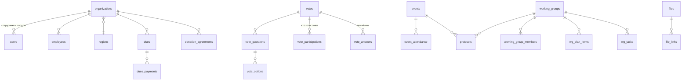

# Портал Альянса «Ценность каждого»: архитектура и схема БД

Статус: **черновик на согласование** (этап 0). Дата: 07.11.2026.

---

## 1. Стек и обоснование

| Слой | Выбор | Почему |
|---|---|---|
| Backend | **Node.js 22 + NestJS 11 + TypeScript** | Один язык на фронте и бэке, общие типы DTO. Модули, guards и interceptors в NestJS хорошо подходят под RBAC и аудит. Swagger генерируется из декораторов. |
| ORM / миграции | **Prisma** + ручные SQL-миграции там, где нужно | Типобезопасные запросы, версионируемые миграции, сиды. Триггеры, права ролей БД и CHECK-ограничения пишутся на чистом SQL внутри миграций. |
| БД | **PostgreSQL 16** | По ТЗ. `timestamptz` хранится в UTC, показывается в Europe/Moscow. |
| Фоновые задачи | **pg-boss** (очередь на базе Postgres) | Напоминания, рассылки, закрытие голосований по сроку, пометка просроченных взносов. Redis не нужен: на один сервис меньше. |
| Файлы | **S3-совместимое хранилище (MinIO)** в docker; драйвер «локальный диск» для разработки | Метаданные лежат в таблице `files`, сами байты в бакете. Скачивание только через бэкенд, с проверкой прав. |
| PDF | **pdfmake** со встроенным шрифтом с кириллицей (PT Sans / Roboto) | Протоколы голосований и встреч, работает без headless-браузера. |
| Email | **nodemailer**; в dev — **Mailpit** (перехватывает письма, веб-просмотр) | Шаблоны редактируются в админке (таблица `email_templates`, Handlebars). |
| Frontend | **React 18 + TypeScript + Vite**, React Router, TanStack Query, **Mantine UI**, react-hook-form + zod | Mantine даёт таблицы, формы, календарь и дату/время с русской локалью «из коробки». Вёрстка desktop-first с рабочим mobile. |
| Карта | Собственный компонент на **SVG регионов РФ** (статический файл в репозитории) | Внешние картографические API не используются. Регион связан с SVG по коду субъекта (`regions.code`). |
| Безопасность | argon2id, JWT access (15 мин) + refresh в httpOnly-cookie с ротацией, TOTP 2FA (otplib), helmet, CSRF-токен (double submit) для cookie-эндпоинтов, `@nestjs/throttler` + блокировка после N неудачных входов, sanitize-html для форматированного текста | |
| Тесты | Jest (unit), Supertest + отдельная тестовая БД (интеграционные), Vitest + Testing Library (фронт, точечно) | |
| Деплой | docker-compose: `app` (API + собранный фронт за nginx), `db`, `minio`, `mailpit` (только dev) | Плюс `scripts/backup.sh` (pg_dump + mc mirror), ротация бэкапов. |

## 2. Архитектура: модульный монолит

```
alliance-portal/
├── backend/                 NestJS
│   ├── prisma/              schema.prisma, migrations/, seed.ts
│   └── src/
│       ├── common/          guards (Auth, Roles, Policy), interceptors (Audit), фильтры, пагинация
│       ├── auth/            логин, refresh, 2FA, приглашения, сброс пароля
│       ├── access/          RBAC: вычисление прав пользователя, политики на уровне ресурса
│       ├── users/  organizations/  employees/  regions/
│       ├── votes/           голосования, бюллетени, итоги, PDF
│       ├── dues/            взносы, платежи, договоры
│       ├── events/          мероприятия, участие, посещаемость
│       ├── protocols/       протоколы общих встреч и РГ
│       ├── working-groups/  планы, задачи, комментарии
│       ├── map/  contacts/  dashboard/
│       ├── files/           загрузка и выдача файлов с проверкой прав
│       ├── notifications/   in-app + email, шаблоны, очередь
│       ├── audit/  settings/
│       └── jobs/            обработчики pg-boss
├── frontend/                React + Vite
├── docker/                  nginx.conf, Dockerfile'ы
├── scripts/                 backup.sh, restore.sh
├── docker-compose.yml  docker-compose.dev.yml
└── docs/
```

Ключевые принципы:
- **Авторизация в два слоя.** `RolesGuard` проверяет право на действие (`votes.create`, `dues.read_all`…). `PolicyService` проверяет права на конкретный объект: «руководитель именно этой РГ», «своя организация», «контакт открыт для сообщества». Фронт скрывает недоступные кнопки, но решение всегда принимает бэкенд.
- **Аудит** — явные вызовы `audit.log()` в сервисах. Пишет состояние до и после изменения. Таблица только для добавления (append-only).
- **Время**: в БД UTC, при выводе Europe/Moscow. Сроки (дедлайн голосования, срок взноса) вводятся и показываются по Москве.

## 3. Модель ролей

Роль складывается из трёх независимых признаков:

| Признак | Где хранится | Значения |
|---|---|---|
| Системная роль | `users.system_role` | `ADMIN`, `SECRETARY`, `USER` |
| Особые права «видеть всё» | `users.can_view_all` | bool (выдаёт только администратор) |
| Статус в Альянсе | `organizations.status` (организация пользователя) | `CANDIDATE`, `MEMBER`, `PARTNER`, `SUSPENDED`, `EXITED` |
| Руководитель РГ | `working_group_members.role = LEAD` | на уровне конкретной группы |

Матрица (кратко):

| Действие | Админ | Секретарь | «Видит всё» | Рук. РГ | Член | Кандидат | Партнёр |
|---|---|---|---|---|---|---|---|
| Пользователи, роли, настройки | ✅ | — | — | — | — | — | — |
| Создание голосований, мероприятий, протоколов общих встреч | ✅ | ✅ | — | — | — | — | — |
| Чтение всех взносов, поимённых итогов голосований, протоколов | ✅ | ✅ | ✅ | — | — | — | — |
| Учёт взносов (ввод платежей) | ✅ | ✅ | — | — | — | — | — |
| Голосовать | по списку участников голосования | | | ✅ | ✅ | — | — |
| Своя РГ: планы, протоколы, задачи, файлы | ✅ | ✅ | чтение | ✅ (своя) | комментарии, отметка задач | — | — |
| Карта | ✅ | ✅ | ✅ | ✅ | ✅ | ✅ | ✅ |
| Контакты на карте и в справочнике | ✅ | ✅ | ✅ | ✅ | ✅ | — | — |
| Материалы с флагом «для партнёров» | ✅ | ✅ | ✅ | ✅ | ✅ | — | ✅ |
| Голосование по своей кандидатуре | — | — | — | — | — | скрыто до решения | — |

2FA обязательна для `ADMIN` и `SECRETARY`: без подтверждённого TOTP такой пользователь после входа видит только страницу настройки 2FA. Для остальных 2FA можно включить по желанию.

## 4. Принятые решения (согласовано 07.11.2026)

1. **Тайных голосований нет.** Все голосования открытые и поимённые, включая приём новых членов. Итоги видны в реальном времени.
2. **Одна организация — один голос.** Голосует учётная запись организации: её руководитель или тот, кому руководитель передал доступ. В голосе фиксируется, какой пользователь его подал. Изменить голос можно до дедлайна.
3. **Регионы**: справочник из 89 субъектов.
4. **Частные специалисты** хранятся в таблице `organizations` с видом `INDIVIDUAL`.
5. **Правила подсчёта голосов** (реализованы в `backend/src/votes/vote-logic.ts`, покрыты unit-тестами):
   - кворум: проголосовавших организаций ≥ `quorum_percent` от списка участников;
   - «за / против / воздержался»: решение принято, если есть кворум и «за» > ½ проголосовавших по вопросу;
   - один вариант: максимум голосов, при равенстве — ничья;
   - несколько вариантов: варианты упорядочиваются по числу голосов;
   - рейтинг: метод Борда (n баллов за 1-е место, n−1 за 2-е…).
6. **Окружение разработки** без Docker: PostgreSQL запускается из npm-пакета `embedded-postgres`, файлы хранятся на локальном диске, письма в dev пишутся в папку `backend/var/mail` (.eml) и в лог. docker-compose (Postgres + MinIO + Mailpit) пишется для деплоя.

## 5. Схема БД

Обозначения: PK — первичный ключ, FK — внешний ключ, UQ — уникальность. Все таблицы имеют `created_at`/`updated_at`, кроме таблиц тайных бюллетеней.

### 5.1 Идентификация и доступ

```
users
  id PK uuid
  email UQ (citext)
  password_hash                      -- argon2id
  full_name, phone, position
  organization_id FK → organizations (nullable: у админа/секретаря может не быть организации)
  system_role enum(ADMIN, SECRETARY, USER)
  can_view_all bool
  status enum(INVITED, ACTIVE, BLOCKED)
  totp_secret_enc, totp_enabled_at   -- секрет зашифрован ключом из env
  failed_logins int, locked_until
  contact_privacy jsonb              -- {email: COMMUNITY|ADMINS, phone: …}
  last_login_at

invitations
  id PK, email, token_hash UQ, organization_id FK, system_role,
  created_by FK → users, expires_at, used_at

refresh_sessions
  id PK, user_id FK, token_hash UQ, family_id, user_agent, ip, expires_at, revoked_at
  -- повторное использование refresh-токена отзывает всё семейство сессий

password_resets
  id PK, user_id FK, token_hash UQ, expires_at, used_at
```

### 5.2 Организации, сотрудники, регионы

```
regions
  code PK (напр. "RU-MOW"), name, federal_district, svg_path_id

organizations                         -- участник Альянса: организация или частный специалист
  id PK
  kind enum(ORGANIZATION, INDIVIDUAL)
  status enum(CANDIDATE, MEMBER, PARTNER, SUSPENDED, EXITED)
  name, short_name, inn, ogrn, kpp, legal_address, postal_address
  region_code FK → regions
  city, lat, lng                      -- необязательные, для точной позиции маркера
  activity_areas text[]
  description (sanitized HTML), website, email, phone
  head_name, head_position
  logo_file_id FK → files
  joined_at, show_on_map bool
  contact_privacy jsonb

organization_status_history
  id PK, organization_id FK, from_status, to_status, reason, vote_id FK (nullable), changed_by FK, changed_at

candidate_applications
  id PK, organization_id FK UQ, questionnaire jsonb, status enum(DRAFT, SUBMITTED, UNDER_REVIEW, APPROVED, REJECTED),
  submitted_at, decided_at, admission_vote_id FK → votes

employees                             -- сотрудники организации-члена
  id PK, organization_id FK, user_id FK (nullable: у сотрудника может не быть входа)
  full_name, position, email, phone, contact_privacy jsonb

responsibility_areas                  -- справочник: «мероприятия», «взносы», «РГ» …
  id PK, code UQ, name

employee_responsibilities
  employee_id FK, area_id FK, working_group_id FK (nullable, для «РГ X»)
  PK(employee_id, area_id, working_group_id)
```

### 5.3 Файлы

```
files
  id PK, storage_key UQ, original_name, mime, size, sha256, uploaded_by FK, created_at

file_links                            -- полиморфная привязка; права проверяются по сущности-владельцу
  file_id FK, entity_type enum(VOTE, DUES, AGREEMENT, PAYMENT, EVENT, PROTOCOL, WORKING_GROUP, TASK, ORGANIZATION)
  entity_id uuid, doc_type (AGREEMENT, PAYMENT_ORDER, ACT, ATTACHMENT …)
  visible_to_partners bool
  PK(file_id, entity_type, entity_id)
```

### 5.4 Голосования

```
votes
  id PK, number UQ (сквозной номер для протоколов)
  title, description
  scenario enum(DOCUMENT_APPROVAL, EVENT_PARTICIPATION, ADMISSION, ELECTION, OTHER)
  status enum(DRAFT, ACTIVE, CLOSED, CANCELLED)
  starts_at, ends_at, closed_at
  quorum_percent                     -- по умолчанию из settings
  eligibility enum(ALL_MEMBERS, LIST, PAID_DUES)
  subject_organization_id FK         -- кандидат при приёме (скрыто от него до решения)
  reminders jsonb                    -- напр. [{"before_hours":48},{"before_hours":2}]
  result jsonb                       -- зафиксированные итоги после закрытия
  protocol_file_id FK → files
  created_by FK

vote_questions
  id PK, vote_id FK, position, text
  format enum(YES_NO_ABSTAIN, SINGLE, MULTIPLE, RANKING)
  min_choices, max_choices

vote_options
  id PK, question_id FK, position, text   -- для YES_NO_ABSTAIN создаются автоматически

vote_eligible_voters                  -- снимок состава на момент старта
  vote_id FK, organization_id FK, PK(vote_id, organization_id)

vote_participations                   -- факт голосования организации
  vote_id FK, organization_id FK, voted_by_user_id FK, voted_at, updated_at
  PK(vote_id, organization_id)

vote_answers
  id PK, vote_id FK, organization_id FK, question_id FK, option_id FK, rank (для RANKING)
  FK(vote_id, organization_id) → vote_participations

vote_reminder_log
  vote_id FK, organization_id FK, kind, sent_at
```

Голосование ведётся по принципу **«1 член Альянса = 1 голос»**: голос подаёт учётная запись организации. До дедлайна голос можно изменить; аудит хранит историю изменений.

### 5.5 Взносы и договоры

```
dues_settings
  year PK, amount, due_date, grace_days, voting_requires_paid bool

dues                                  -- начисление на организацию за год
  id PK, organization_id FK, year FK → dues_settings, amount_due, due_date
  status enum(UNPAID, PARTIAL, PAID, OVERDUE, WAIVED)   -- пересчитывается при платеже и задачей по расписанию
  note
  UQ(organization_id, year)

dues_payments
  id PK, dues_id FK, amount, paid_at, document_number, recorded_by FK
  -- файлы платёжки и акта через file_links(entity_type=PAYMENT)

donation_agreements
  id PK, organization_id FK, number, signed_at, year, amount, status enum(DRAFT, SIGNED, TERMINATED)
  -- файл договора через file_links(entity_type=AGREEMENT)
```

### 5.6 Мероприятия и протоколы

```
events
  id PK, title, description
  type enum(GENERAL_MEETING, CONFERENCE, WORKING_GROUP_MEETING, OTHER)
  format enum(OFFLINE, ONLINE, HYBRID), location, online_url
  starts_at, ends_at, registration_deadline
  working_group_id FK (nullable), visible_to_partners bool
  status enum(PLANNED, HELD, CANCELLED), created_by FK

event_attendance                      -- учёт по пользователю, организация денормализована для статистики
  event_id FK, user_id FK, organization_id FK
  registration enum(INVITED, CONFIRMED_OFFLINE, CONFIRMED_ONLINE, DECLINED)
  presence enum(UNKNOWN, PRESENT_OFFLINE, PRESENT_ONLINE, ABSENT)
  marked_by FK, marked_at
  PK(event_id, user_id)

protocols                             -- общие встречи и встречи РГ
  id PK, number, title, held_at
  event_id FK (nullable), working_group_id FK (nullable)
  status enum(DRAFT, PUBLISHED), author_id FK, published_at
  visible_to_partners bool

protocol_items                        -- повестка и решения
  id PK, protocol_id FK, position, agenda_text, discussion, decision, vote_id FK (nullable)
```

### 5.7 Рабочие группы

```
working_groups
  id PK, name, goals, description, status enum(ACTIVE, ARCHIVED)

working_group_members
  working_group_id FK, user_id FK, role enum(LEAD, MEMBER), joined_at
  PK(working_group_id, user_id)

wg_plan_items
  id PK, working_group_id FK, title, description, start_date, due_date,
  status enum(PLANNED, IN_PROGRESS, DONE, CANCELLED), responsible_user_id FK

wg_tasks
  id PK, working_group_id FK, plan_item_id FK (nullable), title, description,
  assignee_user_id FK, due_date, status enum(TODO, IN_PROGRESS, DONE), created_by FK, done_at

comments                              -- полиморфные: задачи, пункты плана, протоколы
  id PK, entity_type, entity_id, author_id FK, body, created_at, edited_at
```

### 5.8 Уведомления, настройки, аудит

```
notifications
  id PK, user_id FK, type, title, body, link, read_at, created_at

notification_preferences
  user_id FK, type, in_app bool, email bool, PK(user_id, type)

email_templates
  code PK (VOTE_STARTED, VOTE_REMINDER, EVENT_INVITE, DUES_REMINDER, INVITATION …), subject, body_html, updated_by, updated_at

settings
  key PK, value jsonb                 -- кворум по умолчанию, связь взноса с голосованием, параметры напоминаний

audit_log                             -- только добавление: триггер запрещает UPDATE/DELETE
  id bigserial PK, actor_user_id FK, action, entity_type, entity_id,
  before jsonb, after jsonb, ip, user_agent, created_at
```

### 5.9 Производные данные (VIEW, без хранения)

- `v_activity_rating` — по организации: доля посещённых встреч, доля голосований, где она участвовала, активность в РГ (задачи, комментарии), статус взноса. Используется в рейтинге на дашборде.
- `v_region_counters` — количество членов, кандидатов и партнёров по регионам для карты.

### 5.10 Связи (упрощённая ER-диаграмма)



## 6. Этап 1: что войдёт

- Каркас монорепозитория, docker-compose, Prisma-схема **целиком** (все таблицы сразу, чтобы потом не ломать миграции), сиды справочников.
- Auth: вход, refresh с ротацией, выход, приглашения, сброс пароля, TOTP 2FA с обязательностью для админа и секретаря, rate-limit и блокировка.
- RBAC: guards, политики, матрица прав. Unit-тесты на матрицу.
- Организации и пользователи: CRUD, смена статуса (кандидат → член) с историей, профиль своей организации, сотрудники и области ответственности.
- Админка: пользователи, приглашения, роли и особые права, журнал аудита (просмотр).
- Frontend: макет приложения (меню по ролям), вход и 2FA, страницы из списка выше.
- README по запуску, Swagger по адресу `/api/docs`.

